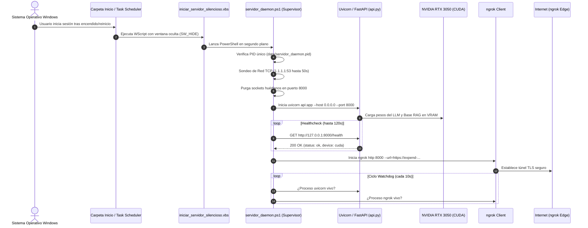
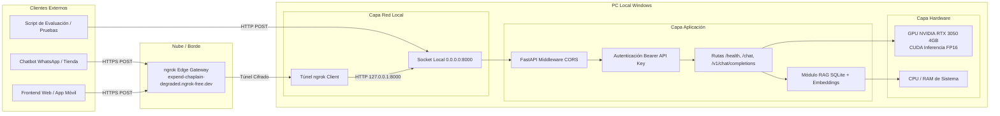
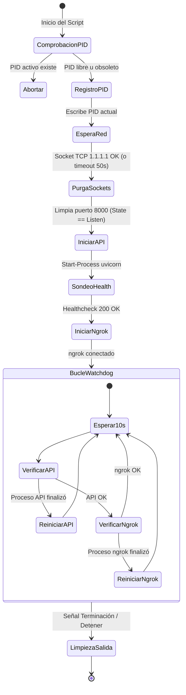

# 📘 Manual Técnico y Especificaciones de Arquitectura: Servidor IA AURA

Sistema de inferencia local con inteligencia artificial soberana, exposición pública segura mediante túnel inverso y subsistema de autoarranque persistente con supervisión continua (Watchdog) para entornos Windows.

---

## 📑 Tabla de Contenido
1. [Visión General y Objetivos del Sistema](#1-visión-general-y-objetivos-del-sistema)
2. [Arquitectura de Alto Nivel y Diagramas](#2-arquitectura-de-alto-nivel-y-diagramas)
3. [Especificaciones de Hardware y Runtime de GPU](#3-especificaciones-de-hardware-y-runtime-de-gpu)
4. [Subsistema de Autoarranque y Persistencia](#4-subsistema-de-autoarranque-y-persistencia)
5. [Especificaciones del Demonio Supervisor (Watchdog)](#5-especificaciones-del-demonio-supervisor-watchdog)
6. [Topología de Red, Túnel Público y Puertos](#6-topología-de-red-túnel-público-y-puertos)
7. [Seguridad, Autenticación y Contrato de la API](#7-seguridad-autenticación-y-contrato-de-la-api)
8. [Desglose Técnico de Archivos y Scripts](#8-desglose-técnico-de-archivos-y-scripts)
9. [Sistema de Registro y Auditoría (Logs)](#9-sistema-de-registro-y-auditoría-logs)
10. [Procedimientos Operativos Estándar (SOP) y Troubleshooting](#10-procedimientos-operativos-estándar-sop-y-troubleshooting)

---

## 1. Visión General y Objetivos del Sistema

El proyecto **AURA** opera como un consultor y asesor de alta perfumería impulsado por un modelo de lenguaje de pesos abiertos optimizado mediante **SFT (Supervised Fine-Tuning)** y **DPO (Direct Preference Optimization)**, enriquecido con recuperación contextual **RAG** (SQLite + RapidFuzz + Embeddings vectoriales).

### Objetivos de la Infraestructura de Servidor:
1. **Disponibilidad Permanente (Alta Disponibilidad Local)**: El servidor debe operar de forma ininterrumpida como un servicio daemon. Si la computadora se apaga, se reinicia por actualizaciones de Windows o sufre un corte de energía, todos los servicios deben reanudarse automáticamente al iniciar sesión sin requerir intervención humana.
2. **Acceso Híbrido (Local y Remoto)**: Exponer la API tanto en la red local (`0.0.0.0:8000`) como en internet mediante una URL fija y cifrada con TLS (`https://expend-chaplain-degraded.ngrok-free.dev`), permitiendo su consumo por aplicaciones móviles, chatbots de WhatsApp o frontends web.
3. **Resiliencia y Auto-Recuperación (Self-Healing)**: Implementar un bucle de supervisión activa que detecte anomalías, procesos caídos o pérdidas temporales de conexión a Internet y recupere el servicio de inmediato.
4. **Coexistencia con el Flujo de Entrenamiento**: Permitir una parada limpia del servidor con un solo clic para liberar la memoria VRAM de la GPU cuando se requiera ejecutar nuevos ciclos de entrenamiento (`src/train_sft.py` o `src/train_dpo.py`).

---

## 2. Arquitectura de Alto Nivel y Diagramas

### A. Diagrama de Secuencia de Autoarranque en Windows



### B. Topología de Comunicación y Flujo de Peticiones



---

## 3. Especificaciones de Hardware y Runtime de GPU

### A. Especificaciones del Hardware
- **GPU**: NVIDIA GeForce RTX 3050 Laptop / Desktop.
- **VRAM Total**: 4.096 MB (4 GB) GDDR6.
- **Compute Capability**: 8.6 (Arquitectura Ampere).
- **Backend de Aceleración**: PyTorch con soporte CUDA (`torch.cuda.is_available() == True`).

### B. Presupuesto de Memoria VRAM y Formato de Datos
El runtime está configurado para balancear velocidad, precisión y consumo estricto de memoria:

| Componente | Tipo de Dato / Cuantización | Consumo VRAM | Ubicación |
| :--- | :--- | :--- | :--- |
| **Pesos Base Qwen 2.5 (500M)** | `torch.float16` / `bfloat16` | ≈ 980 MB | VRAM GPU |
| **Adaptadores LoRA (SFT + DPO)** | `torch.float16` | ≈ 120 MB | VRAM GPU |
| **Context Window (KV Cache)** | 2.048 tokens dinámicos | ≈ 350 MB | VRAM GPU |
| **Overhead de Contexto CUDA** | Contexto y buffers PyTorch | ≈ 250 MB | VRAM GPU |
| **Base de Conocimiento RAG** | SQLite + Índices RapidFuzz | ≈ 120 MB | Memoria RAM Sistema |
| **Vectores de Catálogo (product_embeddings.npy)** | NumPy float32 | ≈ 60 MB | Memoria RAM Sistema |
| **Margen Libre Disponible en GPU** | - | **≈ 2.380 MB** | VRAM GPU |

### C. Por qué no se usó un Servicio Nativo de Windows (Session 0 Isolation)
Una decisión de arquitectura crucial fue **no registrar la IA como un Servicio del Sistema de Windows tradicional (LocalSystem / Session 0)** mediante `sc.exe` o `nssm.exe`.

**Motivo técnico**:
1. En Windows, los servicios corren en la sesión aislada **Session 0**, la cual carece de subsistema de renderizado gráfico interactivo.
2. El controlador de gráficos de NVIDIA para Windows (WDDM - *Windows Display Driver Model*) **deshabilita el contexto CUDA en Session 0** para GPUs de consumo (GeForce RTX), provocando excepciones fatales `CUDA error: no CUDA-capable device is detected` o degradando la ejecución a CPU.
3. Al utilizar la carpeta de inicio de sesión (`shell:startup`) y el Programador de Tareas configurado como `ONLOGON` para el usuario interactivo, el proceso hereda la sesión activa de escritorio, garantizando **acceso al 100% de la aceleración CUDA por hardware, controladores NVIDIA actualizados y las credenciales de usuario de ngrok**.

---

## 4. Subsistema de Autoarranque y Persistencia

El subsistema de inicio automático se basa en un esquema de **doble persistencia** para asegurar que siempre arranque sin requerir permisos elevados de administrador ni mostrar consolas visibles.

### A. Punto de Entrada 1: Carpeta de Inicio de Usuario (`shell:startup`)
- **Ruta Física**: `%APPDATA%\Microsoft\Windows\Start Menu\Programs\Startup\Servidor_IA_AURA.lnk`
- **Mecanismo**: Windows Explorer invoca cada elemento de esta carpeta al completar el inicio de sesión.
- **Acción**: Ejecuta `wscript.exe` pasando como parámetro `iniciar_servidor_silencioso.vbs`.
- **Ventaja**: No requiere privilegios de Administrador ni UAC (Control de Cuentas de Usuario); nunca genera errores de "Acceso Denegado".

### B. Punto de Entrada 2: Tarea Programada de Windows (Opcional / Respaldo)
- **Nombre de la Tarea**: `ServidorIA_AURA`
- **Disparador**: `Al iniciar la sesión de cualquier usuario` (`/SC ONLOGON`).
- **Comando de Registro**: `schtasks.exe /Create /TN "ServidorIA_AURA" /TR "wscript.exe \"...\\iniciar_servidor_silencioso.vbs\"" /SC ONLOGON /F`.
- **Ventaja**: Permite configurar reinicio automático si la tarea experimenta un fallo crítico del sistema.

### C. Lanzador Silencioso (`iniciar_servidor_silencioso.vbs`)
Windows abre una consola negra de `cmd.exe` o `powershell.exe` si se ejecuta directamente un script `.bat` o `.ps1`. Para evitar esto, el script VBScript utiliza la interfaz COM `WScript.Shell`:
```vbscript
Set WshShell = CreateObject("WScript.Shell")
cmd = "powershell.exe -NoProfile -WindowStyle Hidden -ExecutionPolicy Bypass -File """ & scriptDir & "\servidor_daemon.ps1"""
WshShell.Run cmd, 0, False
```
- El parámetro `0` corresponde a la constante de Windows `SW_HIDE` (ventana completamente invisible).
- El parámetro `False` indica que no debe bloquearse esperando el fin del proceso, desacoplándolo de la sesión de inicio.

---

## 5. Especificaciones del Demonio Supervisor (Watchdog)

El script [servidor_daemon.ps1](file:///c:/Users/aleja/Desktop/Proyectos/modelo/servidor_daemon.ps1) constituye el núcleo operativo del servidor.

### Fases de Ejecución:



### Detalle de Módulos del Demonio:

#### 1. Prevención de Concurrencia y Control de PID
- Escribe el PID del proceso supervisor en `data/servidor_daemon.pid`.
- Antes de iniciar, consulta si el PID registrado existe en la tabla de procesos del sistema operativo. Si ya está corriendo, aborta inmediatamente evitando colisiones por el puerto 8000.

#### 2. Compensación de Retardo de Red (Network Readiness Probe)
Tras reiniciar Windows, el adaptador Wi-Fi o Ethernet puede tardar entre 5 y 20 segundos en negociar la dirección IP vía DHCP. Si ngrok inicia antes de tener acceso a los servidores DNS, aborta con error de resolución de nombres.
- **Sondeo**: Intenta establecer una conexión TCP directa contra `1.1.1.1:53` (Cloudflare DNS) con un timeout de 2.000 ms.
- **Reintentos**: Hasta 25 intentos espaciados por 2 segundos (máximo 50 segundos).
- En cuanto hay conexión, avanza de inmediato; si tras 50 segundos no hay red, continúa iniciando la API en modo estrictamente local para no congelar el arranque.

#### 3. Higiene de Sockets y Limpieza de Procesos Zombies
Si la máquina experimentó un apagado forzoso, pueden quedar procesos huérfanos ocupando el puerto:
- Consulta `Get-NetTCPConnection -LocalPort 8000 -State Listen`.
- Si existe un proceso activo con `OwningProcess > 0`, emite `Stop-Process -Force`.
- **Diferenciación de `TimeWait`**: Ignora conexiones en estado `TimeWait` (cuyo `OwningProcess` es `0`), ya que corresponden al proceso de desensamblado normal de paquetes TCP del kernel de Windows y no impiden el re-enlace del socket.

#### 4. Modo `PYTHONUNBUFFERED=1`
Por defecto, la salida estándar (stdout) de Python en Windows utiliza un buffer de bloque de 4 KB cuando se redirige a un archivo. El demonio fuerza `$env:PYTHONUNBUFFERED = "1"`, logrando que cada línea generada por FastAPI (`print`, logs de uvicorn, trazas) se escriba en disco en tiempo real en `logs/api.log`.

#### 5. Bucle de Supervisión Activa (Watchdog Loop)
El supervisor ejecuta una comprobación de pulso cada 10 segundos:
- Si `$apiProc.HasExited == $true`: Registra una alerta en `logs/servidor.log`, espera 5 segundos de enfriamiento y relanza la API.
- Si `$ngrokProc.HasExited == $true`: Relanza el túnel hacia el mismo dominio estático sin reiniciar la API ni interrumpir el modelo en GPU.

#### 6. Manejador de Terminación Limpia (`finally`)
Registra un bloque de salida garantizada: si el usuario o el sistema envían una señal de parada, el demonio termina tanto a `uvicorn` como a `ngrok` y elimina el archivo PID, dejando el sistema en estado limpio.

---

## 6. Topología de Red, Túnel Público y Puertos

### A. Direccionamiento y Puertos
- **Interfaz de Enlace**: `0.0.0.0`
- **Puerto Local**: `8000` (Modificable mediante la variable de entorno `PERFUMISTA_PORT`).
- **Acceso Local**:
  - `http://127.0.0.1:8000` (Bucle local / Localhost).
  - `http://<IP_LOCAL_LAN>:8000` (Accesible por otros computadores o celulares conectados a la misma red Wi-Fi).

### B. Especificaciones del Túnel Seguro (ngrok)
- **Dominio Asignado**: `expend-chaplain-degraded.ngrok-free.dev`
- **Protocolo**: HTTPS con cifrado TLS 1.3 terminado en el borde de ngrok.
- **Configuración ngrok**: Almacenada en `%LOCALAPPDATA%\ngrok\ngrok.yml`.
- **Parámetros del Agente**:
  ```powershell
  ngrok http 8000 --url=https://expend-chaplain-degraded.ngrok-free.dev --log=logs/ngrok.log --log-format=logfmt
  ```
  - `--log-format=logfmt`: Deshabilita la interfaz interactiva basada en consola (ncurses) y genera líneas de registro estructuradas de alto rendimiento.

---

## 7. Seguridad, Autenticación y Contrato de la API

La API implementa un modelo de seguridad por capas para proteger los recursos de inferencia contra accesos no autorizados o ataques de denegación de servicio.

### A. Mecanismo de Autenticación
Todas las peticiones a endpoints de inferencia (`/chat`, `/v1/chat/completions`) requieren una llave de acceso válida.

1. **Encabezados Admitidos**:
   - `Authorization: Bearer <API_KEY>` (Estándar RFC 6750).
   - `x-api-key: <API_KEY>` (Encabezado directo de conveniencia).
2. **Validación Criptográfica**: Las llaves se comparan usando `secrets.compare_digest()` para prevenir ataques de temporización (*timing attacks*).
3. **Almacenamiento de Llaves**:
   - Archivo local [data/.api_key](file:///c:/Users/aleja/Desktop/Proyectos/modelo/data/.api_key) (admite múltiples llaves por línea).
   - Variable de entorno de sistema `PERFUMISTA_API_KEY`.

### B. Política de CORS (Cross-Origin Resource Sharing)
Para permitir que aplicaciones web frontend consuman la API sin vulnerabilidades, el middleware de FastAPI filtra los orígenes permitidos:
- Configurado en [data/allowed_origins.json](file:///c:/Users/aleja/Desktop/Proyectos/modelo/data/allowed_origins.json).
- Admite orígenes de desarrollo (`http://localhost:3000`, `http://localhost:5173`) y dominios de producción.
- Preflight `OPTIONS` verificado: si el origen no está en la lista blanca, la petición es rechazada sin consumir tiempo de GPU.

### C. Catálogo de Endpoints

#### 1. `GET /health` (Público)
- **Propósito**: Sonda de salud utilizada por el demonio y monitores de estado externos.
- **Respuesta (200 OK)**:
  ```json
  {
    "status": "ok",
    "model": "aura_v3b",
    "device": "cuda",
    "api_key_set": true
  }
  ```

#### 2. `POST /chat` (Autenticado)
- **Propósito**: Formato nativo de alto rendimiento para el asistente AURA con extracción de productos para tarjetas interactivas.
- **Request Body**:
  ```json
  {
    "message": "Hola, ¿qué perfume amaderado para hombre me recomiendas?",
    "session_id": "sesion_12345",
    "temperature": 0.3,
    "top_p": 0.9,
    "max_tokens": 350
  }
  ```
- **Response Body**:
  ```json
  {
    "response": "Te sugiero **Santal 33** de Le Labo, un perfume amaderado con sándalo y cedro...",
    "session_id": "sesion_12345",
    "res_type": "rag",
    "products": ["Santal 33"]
  }
  ```

#### 3. `POST /v1/chat/completions` (Autenticado)
- **Propósito**: Compatibilidad drop-in con el SDK oficial de OpenAI, LangChain, Flowise o bibliotecas equivalentes.
- **Formato**: OpenAI Chat Completion spec (`choices[0].message.content`, `usage`, etc.).

---

## 8. Desglose Técnico de Archivos y Scripts

### Matriz de Archivos del Subsistema

| Archivo | Ruta Relativa | Lenguaje | Propósito y Comportamiento |
| :--- | :--- | :--- | :--- |
| **`instalar_autoarranque.bat`** | Raíz | Batch | Lanzador amigable de instalación que delega en `scripts/servicio/instalar.ps1` y ofrece arrancar el servicio de inmediato. |
| **`iniciar_servidor_silencioso.vbs`** | Raíz | VBScript | Wrapper COM de ejecución oculta (`SW_HIDE`). Desacopla el proceso de la consola activa. |
| **`servidor_daemon.ps1`** | Raíz | PowerShell | Supervisor Watchdog central. Administra PID, sondeo de red, arranque de API, ngrok y auto-recuperación. |
| **`iniciar_servidor.bat`** | Raíz | Batch | Ejecuta el demonio en modo interactivo (`-Interactive`) mostrando la consola en vivo con trazado por colores. |
| **`estado_servidor.bat`** | Raíz | Batch | Invoca `scripts/servicio/estado.ps1`, consultando en tiempo real el estado del demonio, API local y túnel público. |
| **`detener_servidor.bat`** | Raíz | Batch | Invoca `scripts/servicio/detener.ps1` para terminar limpiamente todos los procesos de IA y liberar la VRAM. |
| **`desinstalar_autoarranque.bat`**| Raíz | Batch | Invoca `scripts/servicio/desinstalar.ps1` para retirar el acceso directo de inicio y la tarea programada. |
| **`scripts/servicio/instalar.ps1`**| `scripts/servicio/` | PowerShell | Lógica de creación del acceso directo `.lnk` en `%APPDATA%\...\Startup` y tarea `schtasks`. |
| **`scripts/servicio/detener.ps1`** | `scripts/servicio/` | PowerShell | Búsqueda CIM/WMI de procesos `uvicorn` y `ngrok`, terminación forzosa y verificación de puerto libre. |
| **`scripts/servicio/estado.ps1`**  | `scripts/servicio/` | PowerShell | Petición REST a `/health`, verificación de PID y formateo de diagnósticos en consola. |
| **`scripts/servicio/desinstalar.ps1`**| `scripts/servicio/`| PowerShell | Eliminación segura de enlaces y tareas programadas sin alterar el código del modelo. |

---

## 9. Sistema de Registro y Auditoría (Logs)

Todos los componentes escriben en la carpeta aislada [logs/](file:///c:/Users/aleja/Desktop/Proyectos/modelo/logs/), la cual está expresamente excluida de Git en [.gitignore](file:///c:/Users/aleja/Desktop/Proyectos/modelo/.gitignore):

```text
c:\Users\aleja\Desktop\Proyectos\modelo\logs\
├── servidor.log       <-- Bitácora histórica del Supervisor Watchdog
├── api.log            <-- Salida estándar en vivo de FastAPI/Uvicorn (stdout)
├── api_error.log      <-- Errores no controlados y trazas de excepción (stderr)
└── ngrok.log          <-- Registro estructurado de conexiones del túnel
```

### Formato de Registro en `servidor.log`:
```text
[YYYY-MM-DD HH:MM:SS] [NIVEL] Mensaje explicativo
```
Ejemplo real capturado durante el arranque:
```text
[2026-10-26 20:12:56] [INFO] === Iniciando Servicio de Servidor IA AURA ===
[2026-10-26 20:12:56] [INFO] ngrok detectado en: C:\Users\aleja\AppData\Local\Microsoft\WinGet\Packages\...
[2026-10-26 20:12:56] [INFO] Comprobando conexión a internet para el túnel...
[2026-10-26 20:12:56] [SUCCESS] Conexión a internet verificada con éxito.
[2026-10-26 20:12:56] [INFO] Iniciando API local con uvicorn (Modelo: aura_v3b, Puerto: 8000)...
[2026-10-26 20:12:56] [INFO] Esperando que el modelo cargue en memoria (puede tardar de 15 a 45 segundos)...
[2026-10-26 20:13:11] [SUCCESS] API local respondiendo correctamente en http://127.0.0.1:8000/health
[2026-10-26 20:13:11] [INFO] Iniciando túnel ngrok hacia https://expend-chaplain-degraded.ngrok-free.dev ...
[2026-10-26 20:13:11] [SUCCESS] Túnel ngrok en ejecución. Dominio público: https://expend-chaplain-degraded.ngrok-free.dev
[2026-10-26 20:13:11] [SUCCESS] Servidor listo y operativo. Entrando en bucle de supervisión continua...
```

---

## 10. Procedimientos Operativos Estándar (SOP) y Troubleshooting

### SOP 1: Cambio de Modelo de IA Activo
Por defecto, el servidor arranca con el modelo especificado en `$env:AURA_MODELO` (o `aura_v3b`). Para cambiar al nuevo modelo (por ejemplo `aura_v7`):
1. Ejecuta [detener_servidor.bat](file:///c:/Users/aleja/Desktop/Proyectos/modelo/detener_servidor.bat).
2. En [servidor_daemon.ps1](file:///c:/Users/aleja/Desktop/Proyectos/modelo/servidor_daemon.ps1), localiza la línea 61:
   ```powershell
   $env:AURA_MODELO = if ($env:AURA_MODELO) { $env:AURA_MODELO } else { "aura_v7" }
   ```
3. Ejecuta [iniciar_servidor.bat](file:///c:/Users/aleja/Desktop/Proyectos/modelo/iniciar_servidor.bat) (o reinicia el equipo).

---

### SOP 2: Detención para Entrenamiento de Modelos
> [!IMPORTANT]
> Entrenar con LoRA/DPO requiere entre 3.2 GB y 3.8 GB de VRAM. Si la API está encendida, se producirá un error `CUDA Out of Memory`.

1. Haz doble clic en [detener_servidor.bat](file:///c:/Users/aleja/Desktop/Proyectos/modelo/detener_servidor.bat).
2. Verifica que el puerto 8000 esté libre (el script lo confirma en color verde).
3. Inicia tu proceso de entrenamiento en terminal:
   ```powershell
   & ./hf-locql/Scripts/python.exe src/train_sft.py
   ```
4. Al finalizar el entrenamiento, vuelve a iniciar el servidor haciendo doble clic en [iniciar_servidor.bat](file:///c:/Users/aleja/Desktop/Proyectos/modelo/iniciar_servidor.bat) o ejecutando `instalar_autoarranque.bat`.

---

### SOP 3: Verificación de Integridad y Pruebas de Seguridad
Para comprobar que el servidor responde a las pruebas de seguridad y contrato de la API:
```powershell
& ./hf-locql/Scripts/python.exe test_api.py
```
El script valida:
- Salud del endpoint `/health`.
- Rechazo HTTP 401 ante peticiones sin clave o con clave inválida.
- Respuesta HTTP 200 con formato JSON válido ante peticiones autenticadas.
- Aceptación y rechazo estricto según la política de CORS.

---

### Guía de Resolución de Problemas (Troubleshooting)

| Síntoma | Causa Raíz Probable | Solución Paso a Paso |
| :--- | :--- | :--- |
| **El túnel ngrok no abre** | No se ha guardado el token de autenticación de ngrok. | Abre PowerShell y ejecuta: `ngrok config add-authtoken <TU_TOKEN>`. Luego ejecuta `ngrok config check` para validar el archivo de configuración. |
| **API responde 401 Unauthorized** | La petición no incluye la API key correcta o el archivo [data/.api_key](file:///c:/Users/aleja/Desktop/Proyectos/modelo/data/.api_key) fue modificado. | Abre [data/.api_key](file:///c:/Users/aleja/Desktop/Proyectos/modelo/data/.api_key), copia una de las claves activas (ej: `pk-...`) y envíala en el encabezado `Authorization: Bearer <CLAVE>`. |
| **Puerto 8000 ocupado tras caída** | Un proceso zombie de Python retiene el socket. | Ejecuta [detener_servidor.bat](file:///c:/Users/aleja/Desktop/Proyectos/modelo/detener_servidor.bat). El script buscará y matará de forma forzosa cualquier proceso en estado `Listen`. |
| **La inferencia corre en CPU en lugar de GPU** | El controlador de NVIDIA se reinició o CUDA no detecta el dispositivo. | Verifica ejecutando: `& ./hf-locql/Scripts/python.exe -c "import torch; print(torch.cuda.is_available())"`. Si devuelve `False`, reinstala el controlador NVIDIA GeForce oficial de la RTX 3050. |
| **No hay respuesta pública pero la local funciona** | Conexión a internet inestable durante el arranque. | Consulta [estado_servidor.bat](file:///c:/Users/aleja/Desktop/Proyectos/modelo/estado_servidor.bat). El supervisor relanzará ngrok automáticamente en el siguiente intervalo de 10 segundos una vez regrese internet. |
